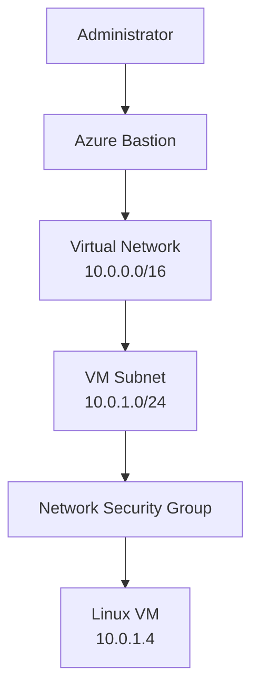

Azure VM Security & Troubleshooting Lab

Project Status

In Progress — learning and documentation lab.

Objective

Learn how Azure virtual machines are connected and secured, and develop a structured approach to troubleshooting common connectivity problems.

Architecture Components

- Azure Virtual Machine: A server running an operating system and applications.
- Virtual Network (VNet): Provides private network connectivity for Azure resources.
- Subnet: Divides a virtual network into smaller IP-address ranges.
- Network Security Group (NSG): Filters inbound and outbound network traffic.
- Azure Bastion: Provides browser-based remote access to VMs through their private IP addresses.

- Network Address Plan

Component| Example address
Virtual Network| 10.0.0.0/16
VM Subnet| 10.0.1.0/24
Linux VM Private IP| 10.0.1.4

Proposed Network Security Rules

Traffic| Protocol / Port| Policy| Reason
SSH administration| TCP 22| Restricted| Permit only approved administrative access
HTTP web traffic| TCP 80| Conditional| Allow only if a public website is required
Unnecessary inbound traffic| Any| Deny| Reduce the VM's attack surface

Security Principles

- Apply least-privilege access.
- Allow only the network traffic required.
- Avoid exposing SSH or RDP directly to the entire internet.
- Verify connectivity and access permissions systematically.

Lab Activities

1. Document the proposed network architecture.
2. Study NSG inbound and outbound rules.
3. Analyse simulated SSH connectivity failures.
4. Document findings, corrective actions and verification steps.

Troubleshooting Scenario 1: SSH Connection Failure

Problem: An administrator cannot connect to a Linux VM using SSH.

Troubleshooting steps:

1. Verify that the VM is running.
2. Check whether an applicable NSG inbound rule allows TCP port 22 from the approved source.
3. Verify the VM's private IP address and network connectivity.
4. Check whether the guest operating system firewall permits SSH.
5. Confirm that the SSH service is running.
6. Retest the connection and document the result.

Security consideration: Avoid allowing SSH from any internet source ("0.0.0.0/0") unless there is a specific, justified requirement. Prefer restricted source addresses or a secure access method such as Azure Bastion.

Troubleshooting Scenario 2: DNS Resolution Failure

Problem: A user can reach a server by IP address but cannot access it using its hostname.

Possible cause: DNS resolution may be failing.

Troubleshooting steps:

1. Confirm that the hostname is spelled correctly.
2. Test whether the hostname resolves to an IP address.
3. Check the device's DNS server configuration.
4. Verify DNS connectivity and whether the DNS server is responding.
5. Retest hostname resolution after correcting the issue.

Security and operational note: Successful connectivity by IP does not prove that every network service is working. DNS resolution must be checked separately.

Lab status: Simulated troubleshooting exercise; no live DNS configuration has been changed.

Troubleshooting Scenario 3: HTTP 503 Service Unavailable

Problem: A user receives an HTTP 503 error when accessing a web application.

Possible causes:

- The application service is stopped or unhealthy.
- The server is overloaded or has insufficient resources.
- A required dependency is unavailable.
- A reverse proxy or gateway cannot reach a healthy backend.

Troubleshooting steps:

1. Reproduce the issue and note the time and error.
2. Check application and service health.
3. Review application and system logs.
4. Check CPU, memory and disk usage.
5. Verify required dependencies and backend connectivity.
6. Apply an appropriate fix and retest the application.

Important: Do not open unnecessary network ports or change IP addresses without evidence that the network configuration is causing the problem.

Lab status: Simulated troubleshooting exercise; no live Azure application has been deployed or tested.

## Architecture Diagram

This is a learning and documentation project. No Azure infrastructure has been deployed as part of the initial activities.
